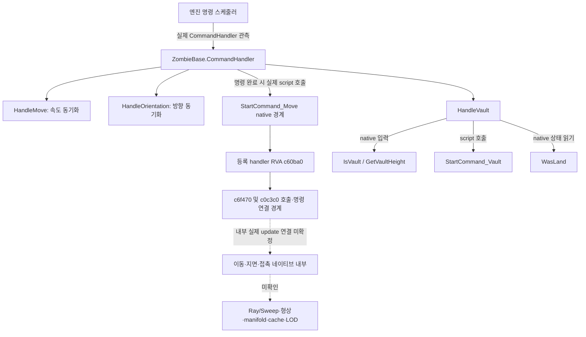

## 1. 작업 목표

바닐라 감염자의 이동·지지·충돌 경계를 기존 자료로 확인하고 커스텀의 물리 비용 개선 방향을 비교한다. 이번 요청은 조사·설계 비교다. 새 알고리즘·게임 실행·전체 회귀·메모리 수정·물리 검사 삭제·PBO 교체는 하지 않았다. 기존 정상 밀침·낙하·착지·FOLLOW·재등반과 실패 자료를 보존한다.

**결론:** 바닐라의 네이티브 이동 명령 사용은 확인됐다. 그러나 발 지지의 실제 함수·형상·접촉 캐시·질의 주기·순수 비용은 아직 확인되지 않았다. 따라서 바닐라가 동일한 일을 더 적은 검사로 한다고 결론낼 수 없다. 현행 SolveContacts는 안전 판정으로 유지하되, 기존 실패를 반복하는 무작정의 ray 축소·배열 재사용보다 이동/밀침의 별도 재검사 소유권을 줄일 수 있는 조건 명세가 우선이다. 네이티브 활용은 별도 호환성 검토 가치가 있지만 현재 AnimalBase에 감염자 명령을 바로 연결할 수 있는 대체 경로는 아니다.

## 2. 실제 수행

설치 scripts.pbo의 해시FF0AD7EE…를 기존 per-agent 증거와 대조하고8개 uncompressed member를 직접 읽었다. DayZInfected/DayZAnimal/ZombieBase의 기존 member SHA도 일치했다. 작업 드라이브 추출본은 이전에 설치본과 불일치했으므로 최종 선언 근거는 설치 PBO다. BohemiaInteractive의 공식 DayZ-Script-Diff도 공개 API 확인용으로 참조했지만 main을 설치 버전의 동일 바이트로 취급하지 않았다.

기존 네 실행 ETL/표본·호출자 분리·개체별1/8/64 비교·query owner·Scratch·Fast/Shadow·현재 SupportContext 보고서를 재사용했다. 대용량 ETL을 재수집하거나 기존 전체 분석을 다시 실행하지 않았다. 기존 Ghidra target은 같은 A500BE80 바이너리로 열려 있었으나 analysis activity는 not_observed였다. 초기화 완료로 가정하거나 전체 자동분석을 재시작하지 않았다. 기존 PE/unwind/Capstone reader를 재사용해 명령 등록7참조와 명시한5개 작은 함수 범위만 추가 정적 확인했다. 런타임 attach나 native 필드 쓰기는 없었다.

## 3. 측정 결과와 호출 흐름

### ① 바닐라에서 확인된 흐름

실선은 설치 선언/명시 script 호출 또는 기존 실행 경계 관측이며, 엔진의 모든 내부 update 순서를 복원한 것이 아니다. 특히 CommandHandler super를 감싼 시간은 하류 엔진 물리 전체가 아니다. StartCommand_Move의 두 보조 함수는 호출 사실만 확인했으며 이름 없는 내부를 ground solver로 명명하지 않았다.

- `ZombieBase.c:198~275`: 사망·동기화·명령 완료·기어가기·피격·vault·mind/fight 전환을 처리한다. 완료 시StartCommand_Move를 호출한다. 매 callback마다 이동 명령을 재시작하는 구조는 아니다.
- `HandleMove:297~307`은 입력 컨트롤러의 속도를 읽고 변화가 크면 SetSynchDirty를 호출한다. 직접 지지 ray를 수행하는 이동 솔버가 아니다.
- `HandleOrientation:314~338`의2초/각도 조건은 네트워크 동기화 dirtying 정책이다. 물리 업데이트를2초마다 한다는 증거가 아니다.
- `HandleVault:413~442`는 native IsVault/GetVaultHeight에서 받은 입력으로 높이별 vault 유형을 고르고 WasLand 상태를 읽는다. 턱 높이 유형 선택은 확인되지만 단차/낙하 시 물리 정밀도 정책은 미확인이다.
- 같은 바이너리의 `GetCommand_Move` handler RVA c60980은 현재 명령을 조회하고 ID0x65(101)를 확인한다. 이는 기존 실행의 MOVE101과 부합한다. 명령 ID 확인은 지지 검사 주기나 알고리즘 확인이 아니다.
- 공개 명령 hook 계약은 `PreAnimUpdate → 애니메이션 처리 → PrePhysUpdate → 물리 처리 → PostPhysUpdate`다. AnimCommandBase와 Infected/Animal script command에 단계가 문서화돼 있다. 실제 바닐라 Move의 모든 단계 호출 빈도·단일 통합 컨트롤러 소유권까지 추적하지는 않았다.

**A 지지 질문별 판정**

|질문|현재 판정|필요한 최소 증거|
|---|---|---|
|실제 지지 함수/물리 컨트롤러|미확인. Move native 진입만 확인|Move update에서 grounded 값을 만드는 함수까지의 호출/데이터 흐름|
|매 update Ray/Sweep 여부|미확인|그 경계의 실제 호출과 업데이트 횟수 대응|
|발별/캡슐/형상/manifold|미확인|해당 controller shape와 query/contact 소비 코드|
|다음 프레임 접촉 재사용|미확인|persistent contact의 쓰기→다음 update 읽기 및 무효화 흐름|
|평지/턱/낙하 정밀도 차이|명령/vault 상태 차이만 부분 확인. 물리 정밀도는 미확인|상태별 실제 query/shape 경로 비교|
|실제 지지 호출 빈도·순수 비용|미확인|객체 식별 가능한 controller/query 경계 및 손실 확인된 표본/시간|

### ② 바닐라와 커스텀 비교

|항목|바닐라|커스텀|해석 한계|
|---|---|---|---|
|이동 소유|Infected native Move 명령|AnimalBase/DayZAnimalCommandScript·자체 DriveGround와Displace|형식·명령·자산 계약이 다름|
|기본 지지|내부 미확인|일반 solver는2발×5offset ray,4관절 sweep; fallback/진단/다른 지면 ray 추가|항상 총14질의라고 고정할 수 없음|
|호출 빈도|MOVE script callback 총약3108~3125/초 관측|1명16.65solve/초,8~64명 개체당약30~32; Drive와Displace 각980~988/게임초(64)|callback 수는 native query 수가 아님. 과거 실험 단위/빌드 구분|
|이전 접촉|캐시/manifold 미확인|Contacts4벡터를 다음 sweep 시작점으로 사용|이전 끝점 보존은 native 접촉 결과 캐시가 아님|
|개체 간 접촉|내부 controller/shape·플레이어 상호작용 미복원|1m 격자·인접3×3 pair 후보,압력/플레이어 검사·Displace·재solve|커스텀 격자는 월드 query broadphase와 다름|
|안전·복구|vault/피격/사망 명령 전환은 확인,낙하 내부 미확인|발 지지·lift 제한·월드 sweep·낙하/착지·재탐색·복구 계약 명시|커스텀은 추가 제작된 수직/접촉 기능이 있음|
|구성|64 native 감염자,기존 선언 골격95본/개체|논리64·native512파트,8compiled skeleton 선언합535본/논리개체|선언본 수를 실제 active본/성능 배수로 쓰지 않음|
|과거 Present p95|24.23~24.44ms|65.47~69.56ms|동일 flat recipe4회 C2 fresh 비교. 최신 network 빌드 수치 아님|
|과거 CPU busy p95|약12.8~13.0ms|약64.5~68.3ms|전체 frame busy; 지지/애니메이션 self-time 아님|
|Ray/Sphere script 경계 표본|낮음,예약0.05%|높음,예약17.2~17.6%|inclusive 표본·분모/표본 선택에 따라 비율 달라짐. native 전체 물리 비교 아님|
|모드 접근|입력 override·명령 전환·script hooks|현재 solver/query/군집 상태는 수정 가능|Infected controller 지지 결과를 Animal로 전달하는 공개 API 미확보|

과거 per-agent와 detailed는 서로 다른 반복/계측 조건이다. 표의 대표 범위는 detailed4회 C2 fresh 기준으로 고정하고 다른 continued/per-agent 범위를 혼합하지 않았다. 이번 새 frame p50/p95/p99는 없다. 기존 정확한 분포는 각 원래 보고서에 보존한다.20ms p95는 미달성 목표다.

## 4. 원인 분석과 최적화 정책 판정

### ③ 바닐라 정책

|정책|바닐라 판정|실제 근거/미확인 경계|커스텀의 기존 상태|
|---|---|---|---|
|Native movement controller|구현됨|native Move 명령 경계·실제101 관측. 내부 지지 소유자는 미확인|같은 감염자 명령이 아닌 자체 이동|
|Animation/Physics synchronization|부분 확인|PreAnim/PrePhys/PostPhys 공개 계약|Animal hook 사용 가능. 전체8파트 동일시간/비용 증명 아님|
|Contact caching|미확인|persistent manifold/재사용 코드 미확보|이전4접촉점 보존만 확인|
|Broadphase|미확인|감염자 내부 후보 선별 호출 미복원|peer 힘 계산용 공간 격자 구현됨|
|Physics LOD|미확인|Animal UpdateSimulationPrecision 존재를 Infected 정책으로 확대하지 않음|현재 precision 설정·제한적 Fast 연구 있음|
|Update throttling|미확인|속도/방향 sync 임계값은 물리 throttling 증거가 아님|경로 재계획 timer는 있으나 물리/포즈 생략과 별개|
|Shared collision data|미확인|질의 간/개체 간 결과 공유 미확보|script scratch 재사용과 물리 결과 공유는 다름|

현재 자료에서 위 정책을 ‘반증’으로 판정할 근거도 없다. 미확인은 미구현을 뜻하지 않는다. 반증 가능한 좁은 주장 두 가지는 구분한다: HandleMove 자체가 발 지지 ray solver라는 설명은 설치 본문과 맞지 않고, script Ray 경계가 작으니 native 물리도 적다는 추론은 자료가 뒷받침하지 않는다.

### 기존 커스텀 연구와 중복

- `SolveContactsInternal`은 같은 호출 안에서 본4개를 raw로 모으고 발 지지 lift를 계산한 뒤 이전 Contacts→새4점 sweep을 검사한다. 단순 발 지지값 반환만 하는 함수가 아니다.
- `DriveGround`는 경로 이동 후 solve하고 실패 시 root/heading/moved를 되돌린다. `Crowd.Displace`는 다른 anchor·기존lift 하한·3높이 몸통 sweep·플레이어/예약/지면 검사를 거친 뒤 solve한다. 두 호출은 같은 상태의 단순 중복이라고 할 수 없다.
- 기존 인접Drive→Displace42쌍의 anchor/heading/minimumLift 완전 일치는0건이었다. 모든 프레임에 재사용 가능성이0이라는 증거는 아니지만 무조건 캐시의 근거는 없다. 포즈·객체 transform·월드 변경까지 포함한 동일성 빈도는 아직 미측정이다.
- `SupportSweepFast`는 등록 컨테이너·중앙ray·footprint·실제 sphere bound·법선·높이 가드 뒤 주변4ray를 대체한다. 임의 평지 캐시가 아니다. Shadow는 원래 판정을 유지하며 비교용 검사를 추가한다. Shadow 자체를 비용 절감으로 보지 않는다.
- 과거 B93D Fast64는63/64와95/96복귀로 미수용이었다. 현행 메서드 비교 두 실행에서는 적격 roof 약26% 국소 감소,terrain 약6.6% 증가가 관찰돼 전역 사용을 수용하지 않았다.
- 후속 SupportContext는 구조물 FOLLOW에만 제한했다. 최초8/64 단일 실행은 통과했지만, 후속 동일조건 OFF/ON 각2회는 모두 기능 실패였고 서버p95 차이도+3ms/−5ms로 방향 불일치였다. 광선 약200만 건 생략을 전체 시간 개선으로 바꾸지 않는다.
- Scratch의 원시/offset 배열 재사용은 현재 두 독립 메서드 비교에서 약1.5~2.5% 감소 경향이나 사전5% 문턱 미달이었다. native query 내부 임시 컨테이너는 script 배열과 별개다. 공개 Ray/Sphere 선언에는 호출자 소유 후보/결과 버퍼 인자가 없다.
- 기존 CPU hot leaf의 Ray 경계 경로는c32c10→564960→ea8f60→eb4540→eb2e60, Sphere는c345e0→566780→ea23e0→eb4420→eb2920이다. malloc/free를 호출하는 코드 범위와 중첩하지만 실제 호출 횟수·할당량·GC·allocator self-time은 미확인이다.

### ④ 적용 후보 평가 — 이번에는 구현하지 않음

|우선/후보|절감 원리와 실제 수정 범위|중복·위험|최소 검증/기존 자료로 가능한 판단|
|---|---|---|---|
|1. 이동·밀침의 재검사 소유권 명세|서로 다른 두 이동 의도를 안전하게 합치거나 재사용 가능한 하위 검사만 식별. 자체 Drive/Displace 호출부는 수정 가능|단순 두 번째solve 삭제는 금지. 경로가 달라지면 벽 통과·밀침/낙하 결과 변동 가능|기존42쌍·caller counter·접촉 입력으로 같은 상태인지 먼저 판정. 실제 합성 후보가 나오면 두 segment의 swept 경로·실패 rollback을 대조해야 함. 현재는 명세 단계|
|2. 네이티브 운반체/이동 명령 활용의 호환성 판정|입력·root 이동을 엔진 명령에 맡길 수 있다면 script query/중복 host 일부를 줄일 가능성. 공개 speed/heading·typed script command 범위|현재 AnimalBase와Infected 명령 소유/생성 계약이 다름. 클래스cast로 연결 불가. native asset/graph·등반·피격·시체/전리품·8파트 복제 위험|이번 설치 API/자산 계약 조사로 drop-in 경로 없음까지 판단 가능. 다음은 실제로 사용할 entity/command/자산 조합 명세. 그것이 성립할 때만1개체 평지의 경계 통제 제안. 현재 시스템 교체 아님|
|3. 지지 판정의 조건부 재사용|검사 위치·footprint·포즈·지지 객체·world revision이 유효한 동안 하위 지지만 재사용. 자체 Floor/solver만 가능|기존 Fast/Shadow와 일부 중복. root Floor와발5ray 최대높이는 다른 양. edge·피격·움직이는 문/발판·낙하에서 stale 위험|원래 반례와 현재 자료로 무조건 재사용 기각 가능. 새 유효조건이 있어야 reference/shadow 비교를 제안. 단순 TTL로 검사 생략하지 않음|
|4. 격자/관심도·갱신 스케줄 연구|peer 후보 수·저위험 먼 개체의 작업량 조절 가능|peer 격자는 이미 있음.64밀집 최악조건에서는 원거리LOD 이득을 기대할 수 없음. 시간/포즈 생략은 기존 끊김 재발 위험|기존pair/query 수·상태별 호출 분포로 부족 영역만 좁힘. 수백 원거리 연구와64근접 안정성은 별도|
|보류. Scratch 확대·Fast 전역화|script allocation/주변ray 감소|이미 국소 효과 부족·terrain overhead·반복 실패. native hot leaf 직접 제거 불가|기존 결과로 당장 재시험/확대할 이유 없음. 새로운 차별 근거가 있어야 재개|

**⑤ 선택 판단:** 현행 안전 솔버를 당장 교체하는 것보다 유지하면서 호출 소유권·통합 가능성을 먼저 규정하는 것이 현실적이다. 다만 더 많은 SolveContacts 내부 미세 최적화만 계속하는 것도 기존 결과상 우선순위가 낮다. 네이티브 활용은 병행 가능한 소규모 호환성 연구지만 ‘바닐라가 싸니까 그대로 가져오면 된다’는 구현 결론은 성립하지 않는다. 예상 절감률은 제시하지 않는다.

## 5. 검증 수준

설치 선언/기존 해시·명령 script·native 등록 및getter ID 경계: 진단 성공. 기존 실험/후속 실패의 이력 비교: 완료. 바닐라 실제 ground 함수·shape/manifold/cache·query 빈도/self-time·물리LOD 정책: 미확인. 새 기능/시각/성능 회귀·최종 수용: 이번에 미실행. 전체 개발 골의 완료를 뜻하지 않는다.

## 6. 변경 사항

이번 변경은 조사 스크립트·파생JSON·보고서·기존 체크포인트/B미러 갱신뿐이다. 게임코드·PBO·모델·운영서버·원본 로그·이전 보고서는 변경하지 않았다. 새PBO/서명 대상이 없고 서명 완료를 새로 주장하지 않는다. 기존 실행의 서명 검증과 이번 설치 PBO의 내용 해시 대조를 구분한다. 기존 미완료 골반 계약 후보의8→64 시험은 이번 조사 요청으로 실행하지 않았다.

## 7. 원시 증거와 재현 범위

- 신규 정적 파생: detailed/vanilla-controller-static-20261103.json, vanilla-command-entry-followup-20261103.json. SDK8member별 SHA·선정행·선정 native 등록7참조·5명시 범위·binary SHA를 저장했다.
- 기존: per-agent/review.md·shipped-script-boundaries-v2·native-class-boundaries·native-slot365-paths; detailed/review.md와query-owner-20261102/owner-audit; b93d-support-fast-20261031-135720; network-gameplay/current-scratch-cost-review·current-support-method-cost-analysis·support-context-review·slot-support-four-review1.
- custom source: DGBNativeGround.c·DGBNativeCrowd.c·DGBGroundAgent.c·DGBNativeTraversal.c. 현재 source/packed contract를 기존owner 감사와 함께 읽고 로컬 무결성 목록에 연결한다.
- 공식 API 보조 출처: https://github.com/BohemiaInteractive/DayZ-Script-Diff/blob/main/scripts/3_game/entities/dayzinfected.c . 온라인main은 설치 버전 증명 대신 사용하지 않았다.

공개는 조사 판정·집계·선정 상대 함수 경계만 제공한다. 설치 자산 전체·원시ETL/로그·로컬 경로·프로세스·키는 공개하지 않는다. 이번에 게임·영상·ETW·dump를 생성하지 않았다. 기존REA 열린 target을 닫거나 초기화를 강제하지 않았다.

## 8. 잔여 문제와 의사결정에 필요한 최소 증거

바닐라 내부를 추가로 추적할 필요가 생기면 질문은 하나로 제한한다: ‘Infected Move의1개 update에서 grounded/contact 값을 누가 만들고, 어떤 결과를 다음 update에 넘기는가’. 필요한 것은 해당 update 경계·실제ground 소비점·shape/contact 수명이다. 현재 StartCommand_Move 등록 handler만 더 오래 분석해도 지원 정책을 자동으로 알 수 없다. 초기화되지 않은 Ghidra 전체 재실행은 하지 않는다.

새 게임 실행을 지금 요청하지 않는다. typed native carrier/자산 조합이 먼저 성립하고 그 결과가 개발 방향을 바꿀 때만,1개체 고정 평지에서 명령update↔grounded↔물리질의의 좁은 관측을 제안할 가치가 있다. 예상 산출물은 support 경계/실제query 수/재사용 수명이며 전체 FPS만 다시 측정하는 시험은 불필요하다. 게임 실행·후킹·구현은 별도 범위 설명 후 결정한다.

현재 비용 절감 후보를 채택하려면 정상 밀침·낙하·착지·FOLLOW·재등반,접촉 실패·rollback,동일조건 반복 성능,시각품질을 각각 확인해야 한다. inclusive 표본을self-time이나‘줄일 수 있는17%’로 바꾸지 않는다. 기능·시각·20ms 목표는 독립 판정한다.

로컬checkpointSHA256: 2304ee1d3a7c432db07512eb290865e95f6bedaddd4ca9c9daffaef32ed1a075
