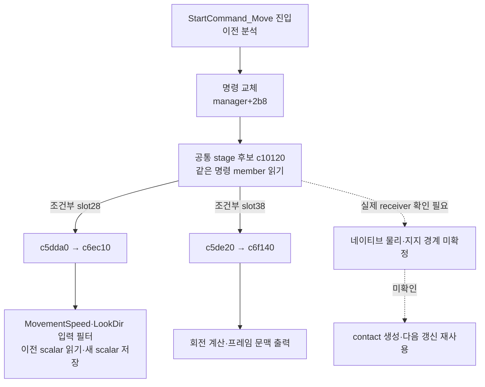

## 1. 작업 목표

이전 바닐라 명령 진입 분석에서 이어서 Move 갱신→지지·접촉 생성→다음 갱신 소비를 추적한다. 기존 결과를 재사용하며 새 게임 실행이 필요하면 먼저 목적·범위·확인 가능한 결과를 설명한다. 이번 묶음에서는 게임을 실행하지 않았다.

**현재 결론:** Move의 생성·소유·갱신 후보 연결과 실제 지속 scalar 필드까지 좁혔다. 그러나 확인한 지속 필드는 애니메이션 입력의 필터 상태이며, 지지·접촉 캐시라는 근거가 아니다. grounded/contact 생산자와 다음 갱신 재사용 연결은 아직 확보하지 못했다.

## 2. 실제 수행

기존 vanilla-command-entry-followup의 StartCommand_Move→등록 handler→명령 교체 분석과 설치 API를 재사용했다. 옛 retail RTTI 기록은 다른 바이너리 해시C6709ECE였으므로 주소를 현재 diag A500BE80에 옮겨 쓰지 않았다. 같은 기존 PE/unwind/Capstone reader로 현재 이미지의 Move/Script 명령 타입3종·각2개 RTTI table과 constructor vptr 쓰기 지점을 읽었다.

명시한 Move 메서드와 공통 manager의 current-command 저장 위치에 연결되는 제한 범위를 추적했다. manager 후보 검색은 RVA c00000~c20000에서 displacement2b8을 실제 명령 피연산자로 확인한 범위로 한정했다. 처음 unwind 조각이 끝나도 실제 branch가 이어지는 Move 회전 함수는 명시한 후속 구간을 별도 저장했다. 이를 provider가 인증한 전체 함수 CFG로 부르지 않는다.

REA binary_session은 기존 열린 대상과SHA 일치를 확인했고 analysis activity=not_observed였다. 초기화된 Ghidra DB가 있다고 가정하지 않았으며 전체 자동 분석을 새로 시작하지 않았다. 런타임 attach·게임 메모리 쓰기·새 게임 실행·PBO 변경·영상/ETW/덤프 수집은 없었다.

## 3. 측정 결과와 새 호출 관계

### 확인한 정적 범위

- 같은 이미지에서 RTTI table6개·vptr 참조6개를 저장했다. Move의 primary subobject0과 command-interface subobject16을 구분했다. 연속 code pointer 수만으로 임의 slot을 유효하다고 단정하지 않고 실제 constructor/dispatch 사용과 대조했다.
- 이전 c0c3c0은 manager+2b8의 명령 포인터를 교체한다. 공통 stage 후보c10120에서 같은 member를 다시 읽고 두 조건부 virtual stage를 호출한다.
- Move 타입의 해당 vtable이 실제 receiver라는 조건 아래, 두 단계는 각각c5dda0→primary slot38→c6ec10, c5de20→primary slot40→c6f140으로 정적으로 연결된다. 실제 실행 receiver/호출 횟수는 이번에 관측하지 않았다.

첫 단계c6ec10은3쌍의 지속 scalar를 읽고 계산한 값을 다시 저장한다. current/auxiliary 쌍은 Move+50/+54, +60/+64, +70/+74다. 명령 초기화c6f270에서 MovementSpeed·MovementDirection·LookDirX·LookDirY 등 그래프 변수 바인딩을 확인했다. 갱신 결과가 해당 그래프 변수 인덱스를 통해 저장되는 경로와 연결되므로, 이 필드들을 발 접촉점이나manifold라고 명명하지 않는다.

회전 단계c6f140은 분기 이후 삼각함수 연산 결과4scalar를 프레임 문맥에 쓴다. 이 함수의 첫 unwind 조각만 읽으면 핵심 후반이 빠진다는 사실을 확인하고 후속 branch 구간을 분리 저장했다. 어떤 미확인 interface flag 호출이 있다고 물리 지지 query라고 부르지 않는다.

새 frame p50/p95/p99·물리 query 수·비용·캐시 적중률·바닐라/커스텀 비교 수치는 없다. 이번 정적 조사에서 성능 개선을 측정하지 않았고20ms p95는 목표다.

## 4. 원인 분석·반증·미확인

**확인:** 기존 명령 진입에서 구체적인 생성 vtable과 두 갱신 후보로 연결을 더 좁혔다. 필드가 호출 사이에 남는다는 사실과 그 필드의 의미를 구분할 수 있게 됐다. 여기서 확인된 재사용은 입력 필터 상태의 재사용이다.

**지지되지 않은 해석:** 이 scalar 지속성을 Contact caching의 증거로 삼을 수 없다. 프레임 변환/회전 문맥을 보존한다는 사실도 단일 통합 물리 컨트롤러나 접촉 결과 재사용을 증명하지 않는다. Grounded라는 exact literal 후보도 확인했지만 주변은 Tyre/Pacejka/Brakes 등의 차량 바퀴 디버그였으므로 감염자 지지 판정으로 채택하지 않았다. 문자열 존재는 실행 경로 증거가 아니다.

**남은 경계:** 실제 live Move의 secondary vtable receiver,공통manager의 실제 owner,다음 물리 interface의 실체,grounded/contact 값을 쓰는 생산자,그 값을 다음 update가 읽는 소비자,무효화 조건,형상·query 빈도와 순수 비용이다. 현재 함수 이름이나 엔진 일반론으로 이 빈칸을 채우지 않는다.

공통 stage 후보의 다른 간접 호출이 어느 native형의 어느 메서드로 해석되는지는 실제 receiver/type 자료가 필요하다. 정적 명령 객체와 현재 게임 개체의 대응이 확보되기 전 광범위한 가상 호출 후보를 계속 따라가는 것은 잘못된 레이어 분석을 늘릴 위험이 있다.

## 5. 검증 수준

동일 바이너리 RTTI·constructor vptr·명령 저장/정적 stage 연결: 제한 진단 성공. 지속 scalar의 그래프 입력 연결: 정적 진단 성공. 실제 Move runtime 갱신·물리 지지 생산/소비·접촉 재사용·반복 성능·기능/시각·최종 수용: 미실행 또는 미확인. 전체 목표 완료로 처리하지 않는다.

## 6. 변경 사항

추가한 것은 bounded trace 스크립트·정적 결과JSON·판정JSON·체크포인트/공개 보고서뿐이다. 원본 실행 파일·설치 API·게임 source·PBO·모델·운영서버·이전 원시자료는 변경하지 않았다. 새 서명 대상이 없다. 기존REA 대상은 재초기화하거나 종료하지 않았다. 골반 계약 후보의8→64 기능 시험도 이번 조사 요청 중 실행하지 않았다.

## 7. 원시 증거와 선택 경계

sourceRunId: matched-flat-pursuit-20261102/detailed/vanilla-move-stage-flow-20261103. 기존 vanilla-command-entry-followup,새 vanilla-move-update-trace·vanilla-move-stage-flow·vanilla-move-stage-findings와 trace_vanilla_move_update 스크립트를 저장 전SHA로 연결했다. 정적 result는 각각선택 table·vptr use·unwind fragment·명시 branch continuation을 담고 제약을 명시한다. 전체 원본 소스 복원이나 새runtime 기록이 아니다.

공개는 상대 함수 경계·집계·필드 의미 판정·미확인 항목만 제공한다. 게임 자산 전체·로컬 경로·프로세스·키·원시 메모리·영상은 공개하지 않는다. 옛 retail 주소는 현재 diag 주소의 증거로 사용하지 않았고,부분 디코드를 완전 함수로 바꾸지 않았다.

## 8. 잔여 문제: 새 실행이 필요한 이유와 예상 산출물 — 아직 실행하지 않음

다음 판정을 바꿀 최소 실행은 기존 flat 하네스의 **바닐라1개체·약30초·읽기 전용 관측**이다. 기존 자산/PBO/AI를 유지하고 게임 메모리 숫자는 쓰지 않는다.64명·회귀시험·성능벤치·새 영상은 필요하지 않다.

목적과 수집 범위:

1. 실제 Move 객체와 manager+2b8의 command-interface가 이번 static vtable과 일치하는지 확인한다.
2. 그 객체의 update 경계와 인접 간접 호출에서 실제 receiver/type/실행 target을 소수 표본으로 확보한다. 임의로ground 함수라고 명명하지 않는다.
3. 검증된 다음 물리 경계가 나오면 연속update의 상태 생산·소비 순서를 제한 표본으로 연결한다. 새벽까지 모든 query를 저장하는 방식은 사용하지 않는다.

**이 실행으로 바로 약속할 수 있는 것:** 실제 stage가 해당 Move에서 실행되는지와 다음 간접 경계의 소유 객체/함수 후보를 좁히는 것. **아직 약속할 수 없는 것:** 접촉 캐시의 존재/적중률,캡슐·발 검사 방식,지지 query 총수와순수 비용,성능 개선. 실제 지지 생산자가 연결된 뒤에야 다음update 재사용을 판정할 수 있다.

중단 조건은 바이너리/receiver 계약 불일치,읽기 전용 observer 오류,30초 또는 소수 이벤트 예산 도달이다. 서비스·방화벽·보안·권한 설정 변경은 하지 않는다. 사용자가 새 실행 범위 설명을 확인하기 전에는 시작하지 않는다. 최종 수용은 정상 밀침·낙하·착지·FOLLOW·재등반 및 독립적인 시각·성능 검증이 여전히 필요하다.

로컬checkpointSHA256: bb5afa6cabf659c7e9bde30c6325a13c3ba9c0d96c8a01d7a6202870b307c9e8
